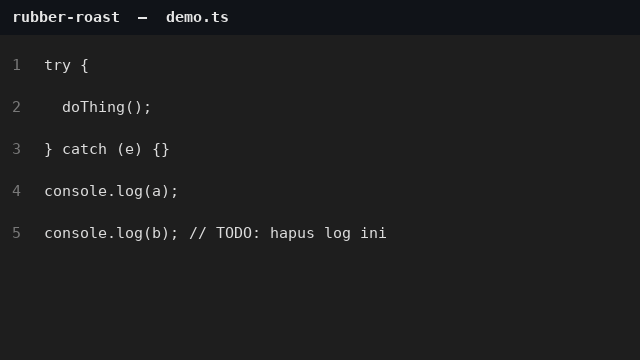

# Rubber Roast

[](https://github.com/Rafax01x/rubber-roast/actions/workflows/ci.yml)
[](https://github.com/Rafax01x/rubber-roast/releases/tag/v1.0.0)
[](LICENSE)

Extension VS Code yang me-roasting kode kamu — dengan sopan, tapi pedas.
A VS Code extension that roasts your code — politely, but spicy.



> Catatan: GIF di atas adalah animasi simulasi dari tampilannya. Ganti file
> `assets/demo.gif` dengan rekaman ScreenToGif / LICEcap dari VS Code yang
> sedang menjalankan extension ini untuk demo yang sesungguhnya.

## Instalasi / Installation

Extension ini belum tersedia di Marketplace, jadi instalasi saat ini lewat
file `.vsix`:

1. Download `rubber-roast-1.0.0.vsix` dari
   [Releases](https://github.com/Rafax01x/rubber-roast/releases/tag/v1.0.0).
2. Di VS Code, buka Extensions, klik menu `...`, pilih
   **Install from VSIX**, lalu pilih file tadi.
3. Simpan file kode apa pun — roasting-nya langsung muncul di akhir baris.

## GIF lucu sesuai kata-kata / Funny GIFs matching the roasts

<details>
<summary>Klik untuk melihat GIF per roasting</summary>

GIF-GIF ini ditemukan di internet (Tenor / Giphy), dipasangkan dengan
pesan roasting-nya, dan disimpan lokal di `assets/` — bukan rekaman
extension ini:

| Pesan roasting | GIF |
|---|---|
| "catch kosong ini bukan error handling, ini pengabaian." / "debug nanti, sekarang pura-pura tidak terjadi apa-apa." |  |
| "console.log ke-6: kamu debugging atau live streaming?" / debugging sampai frustrasi |  |
| "TODO: dikerjakan nanti. Nanti: tidak pernah datang." |  |
| "kode ini minta tolong lewat komentar, dan tidak ada yang menjawab." |  |

Sumber asli: [This Is Fine di Tenor](https://tenor.com/view/this-is-fine-gif-24177057),
[Computing di Giphy](http://giphy.com/gifs/computing-27npJ7KfvMsoM).

</details>

## Fitur / Features

- **Scan on save** — setiap file disimpan, `scanDocument` dijalankan dan
  pesan roasting-nya tampil sebagai teks inline kuning redup di akhir baris
  (satu issue selalu dapat roasting yang sama, jadi teksnya tidak berubah
  tiap save).
- **Roast File command** — jalankan `Roast File` dari Command Palette untuk
  memindai file yang sedang dibuka; ringkasannya muncul di notification,
  detail teknis + roasting-nya di output channel **Rubber Roast**.
- **3 deteksi** — blok `catch` kosong, lebih dari 5 `console.log` dalam
  satu file, dan komentar berisi TODO / FIXME.
- **50 roasting message lucu** — di `src/roasts.ts`, 25 Bahasa Indonesia +
  25 English, dikelompokkan per jenis issue.

## Perintah / Commands

| Command | Fungsi |
|---|---|
| `rubber-roast.roastFile` — Roast File | Pindai file aktif, tampilkan di notification + output channel |

## Pengembangan / Development

```sh
npm install
npm test          # compile + lint + unit test (tanpa VS Code host)
npm run compile   # tsc saja
npm run lint      # eslint saja
```

Tekan `F5` di VS Code untuk menjalankan extension di Extension Development Host.

## Struktur / Structure

```
src/
  scanner.ts        # scanDocument() + tipe RoastIssue
  roasts.ts         # 50 pesan roasting lucu (ID + EN) + roastForIssue()
  extension.ts      # decoration inline + command roastFile
  test/
    scanner.test.ts # unit test scanner (termasuk kind per issue)
    roasts.test.ts  # unit test roasting deterministik
assets/
  icon.png          # ikon extension 128x128
  demo.gif          # GIF demo
.github/workflows/
  ci.yml            # compile + lint + test tiap push ke main
LICENSE             # MIT
```

## Lisensi / License

MIT — lihat file `LICENSE`.

